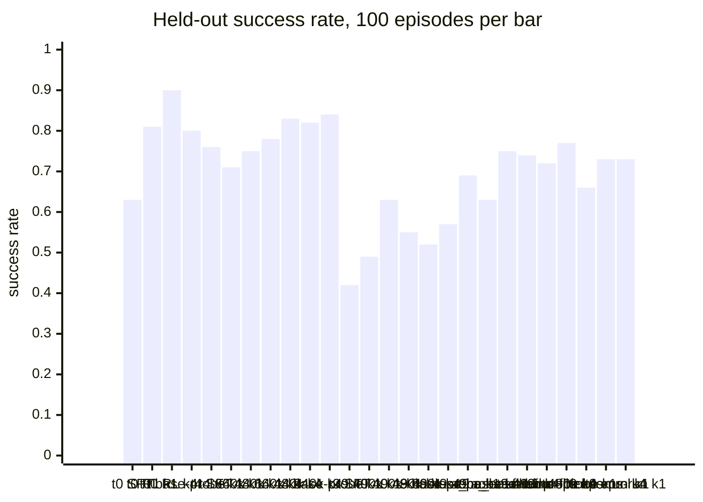

# Single-task DICE-RL on LingBot-VA: held-out results

Protocol: LIBERO-10, one task per run, 100 evaluation episodes per policy = the 50 canonical init states × 2 seeds (`EvalConfig(stage="heldout")`, seed 42). Identical states and seeds for every policy on a task. SFT prior = `libero30-sft` step 600 with best-of-1. RL = frozen prior + residual actor, best-of-4 by critic argmax (the method) or best-of-1 (residual only). 95% intervals are ±0.06–0.10 at n=100. Source: `docs/heldout-results.csv` (this table, with seed-pass splits and intervals) and the per-episode JSON under `result/heldout/<policy>/task_XX/`.

## Results

| task | policy | successes | rate | mean steps | vs SFT paired: gained / lost | states 2/2 · 1/2 · 0/2 |
|---|---|---|---|---|---|---|
| 0 | SFT, best-of-1 | 63 | 0.63 | 388 | — | 21 · 21 · 8 |
| 0 | RL 660k, best-of-1 | 81 | 0.81 | 355 | 26 / 8 | 32 · 17 · 1 |
| 0 | RL 660k, best-of-4 | 90 | 0.90 | 335 | 34 / 7 | 40 · 10 · 0 |
| 0 | base-conditioned actor (offline probe, 660k critic), best-of-1 | 80 | 0.80 | 347 | 23 / 6 | 34 · 12 · 4 |
| 4 | SFT, best-of-1 | 76 | 0.76 | 317 | — | 29 · 18 · 3 |
| 4 | RL 660k, best-of-1 | 71 | 0.71 | 325 | 8 / 13 | 28 · 15 · 7 |
| 4 | RL 480k, best-of-1 | 75 | 0.75 | 313 | 13 / 14 | 26 · 23 · 1 |
| 4 | RL 660k, best-of-4 | 78 | 0.78 | 300 | 12 / 10 | 32 · 14 · 4 |
| 4 | RL 480k, best-of-4 | 83 | 0.83 | 294 | 15 / 8 | 36 · 11 · 3 |
| 4 | RL 240k, best-of-4 | 82 | 0.82 | 290 | 16 / 10 | 36 · 10 · 4 |
| 4 | base-conditioned actor (offline probe, 660k critic), best-of-1 | 84 | 0.84 | 285 | 14 / 6 | 35 · 14 · 1 |
| 9 | SFT, best-of-1 | 42 | 0.42 | 437 | — | 11 · 20 · 19 |
| 9 | RL 400k, best-of-1 | 49 | 0.49 | 418 | 28 / 21 | 14 · 21 · 15 |
| 9 | RL 400k, best-of-4 | 63 | 0.63 | 382 | 33 / 12 | 21 · 21 · 8 |
| 9 | RL 480k, best-of-4 | 55 | 0.55 | 401 | 32 / 19 | 16 · 23 · 11 |
| 9 | RL 660k, best-of-4 | 52 | 0.52 | 404 | 27 / 17 | 10 · 32 · 8 |
| 9 | base-conditioned actor (offline probe, 400k critic), best-of-1 | 57 | 0.57 | 393 | 33 / 18 | 17 · 23 · 10 |
| 9 | base-conditioned actor (offline probe, 400k critic), best-of-4 | 69 | 0.69 | 365 | 39 / 12 | 25 · 19 · 6 |
| 9 | RL (s, a_base) trained from scratch, 660k, best-of-1 | 63 | 0.63 | 373 | 34 / 13 | 17 · 29 · 4 |
| 9 | RL (s, a_base) trained from scratch, 660k, best-of-4 | 75 | 0.75 | 343 | 43 / 10 | 26 · 23 · 1 |
| 9 | RL (s, a_base) trained from scratch, 480k, best-of-4 | 74 | 0.74 | 353 | 41 / 9 | 29 · 16 · 5 |
| 9 | (s, a_base) actor retrained offline with the BC filter at ε = −0.3 (660k critic), best-of-4 | 72 | 0.72 | 345 | 40 / 10 | 28 · 16 · 6 |
| 9 | (s, a_base) actor retrained offline with the BC filter at ε = −0.3 (660k critic), best-of-1 | 77 | 0.77 | 342 | 43 / 8 | 29 · 19 · 2 |
| 9 | (s, a_base) actor retrained offline without the filter, control (660k critic), best-of-1 | 66 | 0.66 | 375 | 38 / 14 | 22 · 22 · 6 |
| 9 | RL (s, a_base) with the filter at ε = −0.3 online, trained from scratch, 480k, best-of-4 | 73 | 0.73 | 353 | 44 / 13 | 27 · 19 · 4 |
| 9 | RL (s, a_base) with the filter at ε = −0.3 online, trained from scratch, 480k, best-of-1 | 73 | 0.73 | 356 | 40 / 9 | 27 · 19 · 4 |

"Gained / lost" pairs each RL episode with the SFT episode on the same init state and seed. "States 2/2 · 1/2 · 0/2" counts init states succeeded on both seeds, one seed, neither. Every failure on every policy is a truncation at 520 steps; no policy fails by termination.

## Training runs

Identical recipe (`docs`: README, "DICE-RL residual training"), 660k env steps, one L40S each. Values below are means over 110k-env-step bins of the logged update metrics (10 gradient steps per 4 chunks) or over collection episodes.

| metric | task 0: 0k → 550k+ | task 4: 0k → 550k+ | task 9: 0k → 550k+ |
|---|---|---|---|
| collection success (procedural resets, best-of-4 after 64k) | 0.75 → 0.87 | 0.76 → 0.87 | 0.46 → 0.67 (400k) → 0.48 (640k) |
| train-eval, 10 procedural episodes (0 / 80k / 240k / 400k / 560k) | 6 / 7 / 9 / 8 / 9 | 6 / 6 / 10 / 9 / 9 | 4 / 8 / 5 / 6 / 3 |
| train-eval ΔV at 80k / 240k / 400k / 560k | 0.006 / 0.060 / 0.021 / 0.071 | 0.001 / 0.007 / 0.001 / 0.003 | 0.001 / 0.024 / 0.017 / 0.004 |
| better_than_base_rate | 0.72 → 0.87 | 0.73 → 0.88 | 0.63 → 0.88 |
| q_advantage | 0.017 → 0.040 | 0.018 → 0.064 | 0.019 → 0.102 |
| q_overestimation_online | +0.136 → −0.028 | +0.146 → +0.049 | +0.148 → −0.027 |
| q_overestimation (all rows) | 0.000 → −0.028 | 0.011 → +0.042 | +0.011 → −0.028 |
| residual_rms | 0.010 → 0.015 | 0.011 → 0.018 | 0.012 → 0.027 |
| actor_grad_norm | 0.20 → 0.22 | 0.19 → 0.33 | 0.35 → 0.72 |
| critic_loss | 0.019 → 0.018 (min 0.011 at 220k) | 0.019 → 0.018 (min 0.013 at 220k) | 0.031 → 0.028 (min 0.019 at 200k) |
| bc_filter_rate | ≥ 0.9994 | ≥ 0.9987 | ≥ 0.995 |

Metric definitions, from `script/lingbot_rl_model.py` and `script/lingbot_rl_train.py`:

- `better_than_base_rate`: fraction of (replay row, stored candidate) pairs with Q(s, a_base + residual) > Q(s, a_base), Q = min over the 10 critics. Computed on training-buffer states with the same critic the actor is optimised against.
- `q_advantage`: batch mean of Q(s, a_base + residual) − Q(s, a_base), same critic and states.
- `q_overestimation`: batch mean of Q(s, a_stored) − Monte-Carlo return, where a_stored is the action executed at collection time, not the actor's current output. `_online` restricts to online rows.
- `train-eval ΔV`: mean of Q(s, a_base + residual) − Q(s, a_base) over 8 fresh prior samples at one procedural reset state (`env.reset(seed=0)`), so a single-state measurement outside the replay buffer.
- `residual_rms`: RMS of the residual over the 7 live action channels × 16 steps, normalised action units.

## Task 9: gain at 400k, decline afterwards

Facts:

1. Held-out best-of-4: 63 at 400k, 55 at 480k, 52 at 660k, against SFT 42. Episodes gained versus SFT stayed at 27–33 across the three checkpoints; episodes lost rose from 12 to 17–19.
2. Collection success rose from 0.46 (first bin) to 0.67 at 400k and fell to 0.48 by 640k; mean episode length went 420 → 374 → 407 over the same range.
3. Train-eval ΔV was 0.024 at 240k, 0.017 at 400k and 0.004 at 560k; train-evals were 4 / 8 / 5 / 6 / 3 of 10.
4. From 400k to 640k: online overestimation went from +0.048 to −0.027 (critic Q on executed actions dropped below the Monte-Carlo return), the critic-predicted advantage of the actor's corrections held at 0.095–0.103, actor gradient norm rose 0.53 → 0.72, critic gradient norm 0.67 → 0.90, critic loss 0.020 → 0.028, residual RMS stayed at 0.026–0.027.
5. Task 9's residual (0.027) and actor gradient norm (0.72) are the largest of the three runs; its critic-predicted advantage (0.10) is the highest.

Conclusions that follow:

- The run's best measured policy is the 400k checkpoint; checkpoints after it lose more SFT successes than they gain. Selecting the final checkpoint would have reported +10 instead of +21.
- The decline coincides with the critic turning pessimistic on executed actions while rating the actor's unexecuted corrections ever higher, and with rising actor and critic gradients against a fixed-size residual. This is the task-4 pattern (its facts 2–4) arriving late, after a period in which the residual transferred.
- Across the three runs, the train-eval ΔV ordering at 240k–400k (task 0 > task 9 > task 4) matches the held-out gain ordering; `better_than_base_rate` and `q_advantage` do not.

6. Best-of-1 at 400k: 49/100 (SFT 42, best-of-4 63). The residual alone adds 7 points; the critic's selection adds a further 14.

Not established: the 240k checkpoint's held-out rate (ΔV peaked there).

## Task 4: why a high better-than-base rate did not carry to the held-out eval

Facts:

1. `better_than_base_rate` (0.88) and `q_advantage` (0.064) are the critic's assessment of the actor's outputs on buffer states, produced by the critic the actor maximises. Neither uses environment returns. Task 0 reached comparable values (0.87, 0.040) and its residual-only held-out gain was +18; task 4's was −5. Across the two runs these metrics do not predict realised gain.
2. The only logged quantity that compares the critic to realised returns, `q_overestimation`, is evaluated on the executed action a_stored, not on a_base + residual. It therefore cannot detect a critic that overrates the actor's residual specifically. On task 4 it stayed positive on online rows for the whole run (+0.146 → +0.049), whereas on task 0 it crossed to negative after 330k (−0.028 at the end).
3. Outside the buffer, the critic's predicted advantage for task 4 is near zero: train-eval ΔV was 0.001–0.007 at every checkpoint (task 0: 0.021–0.071), against a buffer-state `q_advantage` of 0.064. The task-4 advantage the critic reports is concentrated on replayed states.
4. Task 4's residual is larger than task 0's (RMS 0.018 vs 0.015) and its actor gradient norm grew through the run (0.19 → 0.33) while task 0's stayed flat (0.20 → 0.22).
5. Held-out best-of-1 at 660k loses 13 SFT successes and gains 8, and the number of init states failing on both seeds rises from 3 (SFT) to 7. Best-of-1 at 480k is 75/100 (12 gained / 13 lost). Best-of-4 recovers to 12 gained / 10 lost at 660k. The 240k and 480k checkpoints, best-of-4, are the only task-4 policies above the prior by more than their interval's half-width (82, 83 vs 76; ±0.08).
6. Collection success in the final bin (0.866, n=396 unseeded episodes, policy changing within the bin) exceeds the held-out best-of-4 rate at 660k (0.78, n=100). Both sample the same start distribution: 200 procedural resets versus the 50 canonical states give coincident per-object position ranges with all 50 canonical states inside them (tasks 0, 4, 9 checked). The two rates' intervals overlap.
7. All task-4 failures, for every policy, are 520-step truncations; successful episodes average 238–253 steps. RL successes are 6–15 steps faster than SFT successes.
8. The BC filter released BC on ≤0.13% of candidate rows in both runs; β = 100 BC applied throughout.

Conclusions that follow from the facts above:

- On task 4 the residual actor learned a correction the critic rates highly on training states (facts 1, 3) that does not improve, and slightly degrades, success on held-out states (fact 5). The critic's positive online overestimation throughout the run (fact 2) is consistent with, but does not by itself prove, the actor exploiting critic error; the logged overestimation metric cannot settle this because it scores the executed action rather than the actor's output (fact 2).
- The task-4 residual never exceeded the prior on its own at either checkpoint measured (75 at 480k, 71 at 660k, prior 76); the task-4 gain that does exist (best-of-4, 240k–480k, +6–7 points) comes entirely from selection. On task 0 the residual alone accounts for most of the gain (63 → 81 → 90); on task 9 for a third of it (42 → 49 → 63). The three tasks differ in whether the learned residual transfers, not in whether the critic learned to rank candidates.
- The train-eval ΔV, computed on a state outside the buffer, separated the two runs at every checkpoint (fact 3) while `better_than_base_rate` and `q_advantage` did not (fact 1). Of the logged signals, ΔV is the one that tracked the held-out outcome.
- Task 4's SFT prior (0.76) starts above the 40–70% band; task 0 (0.63) and task 9 (0.42) start inside it.

Not established by these data: whether the task-4 residual would transfer with a smaller β, a different critic state, or more seeds; whether the late decline from 480k to 660k (83 → 78, within the interval) is real.

## Sharpening analysis and the residual's input

`script/lingbot_rl_sharpen.py` computes, for every online replay row of a run, ΔV = mean over the 4 stored candidates of Q(s, a_base + r) − Q(s, a_base) and ΔH = entropy of the 4 corrected candidates minus entropy of the 4 base candidates (50-bin histogram over [−1, 1] on the 7 live channels × 16 steps, as in the paper's Figure 5; plus a log-std version). Figures: `result/analysis/figures/`.

| run, checkpoint | mean ΔV | mean ΔH | mean Δlog-std | r(ΔV, ΔH) per state |
|---|---|---|---|---|
| t0 240k / 480k / 660k | 0.022 / 0.033 / 0.047 | +0.037 / +0.034 / +0.032 | +0.14 / +0.14 / +0.13 | +0.28 / +0.49 / +0.56 |
| t4 240k / 480k / 660k | 0.025 / 0.056 / 0.063 | +0.053 / +0.051 / +0.048 | +0.18 / +0.17 / +0.16 | +0.35 / +0.43 / +0.60 |
| t9 240k / 400k / 660k | 0.042 / 0.066 / 0.111 | +0.072 / +0.069 / +0.067 | +0.23 / +0.22 / +0.21 | −0.03 / +0.10 / +0.43 |
| t9 (s, a_base) run, 240k / 400k / 660k | 0.163 / 0.177 / 0.192 | +0.013 / +0.009 / +0.008 | +0.07 / +0.06 / +0.06 | +0.12 / +0.09 / +0.09 |
| t9 (s, a_base) run, ε = −0.3 online, 320k / 400k / 480k | 0.159 / 0.160 / 0.165 | +0.010 / +0.007 / +0.007 | +0.07 / +0.06 / +0.06 | +0.17 / +0.15 / +0.12 |
| t9 plan selection M = 4, (s, a_base), ε = −0.3, 320k (5 / 10 sampler; critic takes the plan pool) | 0.048 | +0.002 | +0.07 | +0.23 (r² 0.05; per episode +0.13) |
| t0 plan selection M = 4, (s, a_base), ε = −0.3, 240k | 0.021 | +0.000 | +0.04 | +0.01 (r² 0.00; per episode +0.04) |

Facts (2026-10-16 rows added; figure `result/analysis/dvdh/dvdh_states_episodes_compare.png`): the two plan-selection runs have ΔH within 0.002 of zero at every ΔV quartile except the top quartile of task 9 (+0.012), and r² of 0.05 and 0.00 per state; the paper's r = −0.18 is r² 0.03 in the contracting direction. Mean ΔH is positive on all nine earlier combinations (the residual spreads the candidates; the paper reports contraction with r = −0.18); r(ΔV, ΔH) rises to +0.43..+0.60 by 660k on every task. On the buffers, z adds nothing to predicting a_base beyond the state (ridge R² 0.47–0.55 with or without z), and the candidate-specific part of the residual is uncorrelated with the candidate's offset (−0.04 to −0.08). The residual's input (s, z) does not locate the candidate it corrects: with this base policy a_base is a 50-step denoise of the 5B model, unlike the paper's small flow.

`script/lingbot_rl_actor_probe.py` retrains fresh actors on a run's buffer against its frozen critic with inputs (s, z), (s, a_base), (s, z, a_base); held-out rows (`result/analysis/probe/summary.csv`):

| run | input | critic gain ΔV | Δlog-std | states sharpened | candidate-specific share | offset corr |
|---|---|---|---|---|---|---|
| t0 660k | z / base / z_base | 0.004 / 0.050 / 0.017 | +0.22 / +0.04 / +0.20 | 1% / 52% / 3% | 65% / 8% / 52% | −0.04 / −0.17 / −0.06 |
| t9 400k | z / base / z_base | 0.006 / 0.133 / 0.053 | +0.30 / +0.07 / +0.25 | 0% / 38% / 1% | 68% / 8% / 45% | −0.06 / −0.19 / −0.08 |
| t4 660k | z / base / z_base | 0.004 / 0.070 / 0.019 | +0.23 / +0.06 / +0.21 | 5% / 50% / 9% | 64% / 10% / 51% | −0.04 / −0.13 / −0.05 |

The (s, a_base) probe actors, each paired with its run's critic, scored on the held-out protocol (table above): task 9 at 400k, 57 best-of-1 and 69 best-of-4 (z-actor: 49 / 63); task 0 at 660k, 80 best-of-1 (z-actor: 81); task 4 at 660k, 84 best-of-1 (z-actor: 71; SFT 76). No new environment data was used for any of them. `residual_input` is now a recipe option (`z`, `base`, `z_base`); a training run with `base` is the pending test.

## Task 9 retrained with the base-conditioned residual

Run `dice-t9-base`: identical recipe, `residual_input: base`, actor and critic trained together from scratch for 660k env steps (W&B `dice-t9-base`). Held-out at 660k: best-of-4 75/100 (43 gained / 10 lost vs SFT; 35 / 12 vs the z-run's 660k; 26 / 14 vs the z-run's best checkpoint at 400k), best-of-1 63/100 (34 / 13 vs SFT; 30 / 16 vs the z-run's 400k best-of-1). Training signals over the same range as the z run: train-evals 4 / 5 / 6 / 6 / 8 (z: 4 / 8 / 5 / 6 / 3), ΔV 0.15–0.22 at every checkpoint (z: 0.001–0.024), collection success 0.77–0.78 at 400k–480k (z: 0.59–0.66), online overestimation negative throughout (−0.02 → −0.11), critic loss flat at 0.028 and actor gradient norm plateaued at 0.85 from 240k (z: both rising late), residual RMS 0.035 (z: 0.026). The late decline of the z run did not occur. The 480k checkpoint, best-of-4, scores 74/100 (41 gained / 9 lost vs SFT; 15 / 16 vs the 660k checkpoint), so the last 180k env steps changed which episodes succeed but not how many. On its own replay buffer the trained (s, a_base) actor leaves the candidate spread almost unchanged (mean ΔH +0.008, Δlog-std +0.06 at 660k, against +0.067 / +0.21 for the z run) while the critic-predicted gain is three times larger (0.19 vs 0.07), and the ΔV–ΔH coupling stays near zero at every checkpoint (r = 0.09–0.12) instead of rising to +0.43.

## BC filter: why it never fires, and an offline probe at ε = −0.3

The filter (paper Eq. 6) releases BC on a row when Q(s, a_cur) > Q(s, a_base) and Q(s, a_stored) − Ĝ(s) < ε. With ε = −0.5 taken literally from the paper's Table 2 it released at most 0.13% of rows in every run. Two measurements on the saved replays explain this. The first condition is non-selective: 99.3% of the base run's online rows (79.7% of the z run's) satisfy it. The second condition is on the wrong scale: the reference n-step target sums 17 overlapping chunk-reward windows, so its Q spans several units and −0.5 is a small margin, whereas ours is bounded by 1. Release fractions of online rows at other ε, measured with each run's critic on its final replay buffer (all / succeeded-episode rows / failed-episode rows): base run 660k critic, ε = 0: 0.87 / 0.99 / 0.72; −0.1: 0.63 / 0.70 / 0.54; −0.2: 0.34 / 0.42 / 0.25; −0.3: 0.14 / 0.20 / 0.06; −0.5: 0.015 / 0.03 / 0.00. z run 400k critic: ε = 0: 0.53 / 0.80 / 0.31; −0.2: 0.10 / 0.21 / 0.01; −0.3: 0.04 / 0.08 / 0.00. Releases on failed-episode rows near ε = 0 come from the unbounded min-ensemble sitting slightly below zero where Ĝ = 0.

Critic calibration on the same rows, Q(s, a_stored) against Ĝ: succeeded episodes 0.72 vs 0.92 (base), 0.73 vs 0.91 (z); failed episodes −0.03 vs 0 (base), +0.21 vs 0 (z). Both critics under-predict successes by about 0.19; the z critic is additionally optimistic on failures. The under-prediction follows from the target, which averages the next-state value over the K stored candidates while the data and Ĝ come from the argmax candidate, and from the min over 10 heads; it is not produced by the BC term, which touches only the actor.

Offline probe (`script/lingbot_rl_actor_probe.py --epsilon -0.3`, variant base, 8000 steps against the base run's 660k critic and buffer, with a no-filter control trained identically): BC keep rate 0.87; on held-out buffer rows residual RMS 0.042 vs 0.036, mean ΔV 0.179 vs 0.165, ΔH +0.011 vs +0.010, Δlog-std +0.076 vs +0.067, r(ΔV, ΔH) +0.12 vs +0.04. Held-out episodes with the same 660k critic: best-of-4 72/100 (40 / 10 vs SFT; 16 / 19 vs the online actor's 75), best-of-1 77/100 (43 / 8 vs SFT; 25 / 11 vs the online actor's best-of-1 at 63; 21 / 16 vs its own best-of-4). The no-filter control actor, trained identically against the same critic, scores 66/100 best-of-1 (38 / 14 vs SFT; 21 / 18 vs the online actor; 12 / 23 vs the filtered actor). Offline retraining alone therefore reproduces the online actor; the 11-point difference between the two offline actors, 23 episodes gained against 12 lost on identical init states and seeds, is the filter's. Both offline actors were evaluated with the same frozen critic, so this measures the actor-side effect only; the online loop the paper describes, where released rows change what is collected, is untested.

## Task 9 with the BC filter active online

Run `dice-t9-base-eps03`: the base-conditioned recipe with ε = −0.3 and a 480k budget, otherwise identical to `dice-t9-base` (W&B `l273q2h0`; 320k env steps on a Brev L40S, the remaining 160k resumed from the 320k save on a Modal L40S; the W&B run carries dead segments between 320k and 342k from a corrupt resume transfer and one preemption, the real continuation is the segment logged from 2026-10-08 07:55 UTC). The filter became live at 128k and released 1–4% of rows by 300k, 5% at 320–360k and 9% by 440–480k (BC keep rate 0.99 → 0.91). Training signals matched the base run throughout: critic loss 0.027–0.029, Q mean 0.49–0.50, critic gain 0.14–0.15, online overestimation −0.06 → −0.10, residual RMS 0.034, collection success 0.72–0.78; train-evals 4 / 6 / 8 / 6 at 0 / 80k / 240k / 400k (base run: 4 / 5 / 6 / 6). No late decline.

Held-out at 480k: best-of-4 73/100 (44 / 13 vs SFT; 19 / 20 vs the base run's 480k best-of-4 at 74; 17 / 19 vs its 660k at 75) and best-of-1 73/100 (40 / 9 vs SFT; 24 / 14 vs the base run's 660k best-of-1 at 63; 18 / 22 vs the offline filtered actor at 77; 22 / 15 vs the offline control at 66). The residual alone gains 10 points over the base run's residual alone, which reproduces the offline probe's direction (77 vs 66) within the interval, and selection adds nothing on top of it (73 vs 73, 18 / 18 paired). With selection the two recipes are indistinguishable (73 vs 74–75). On its own final buffer (30,847 online rows) the filtered actor is distributionally the same as the base run's: mean ΔV 0.16 at every checkpoint (base run 0.16–0.19), mean ΔH +0.007 to +0.010 (a slight expansion; base run +0.008 to +0.013), Δlog-std +0.06 (same), r(ΔV, ΔH) +0.12 to +0.17 (base run +0.09 to +0.12), residual RMS 0.034 (same). In both runs the expansion sits on failed-episode rows (ΔH +0.015) and is absent on succeeded-episode rows (+0.001), while ΔV is larger on succeeded rows (0.19–0.22 vs 0.14–0.16). The held-out gain of the residual alone is not accompanied by any change in the candidates' spread, in the critic-predicted gain, or in the residual's size.

## Decomposition across tasks (20 / 50 sampler)

| task | SFT | residual only (best-of-1) | residual + selection (best-of-4) | checkpoint |
|---|---|---|---|---|
| 0 | 63 | 81 (+18) | 90 (+9 more) | 660k |
| 9 | 42 | 49 (+7) | 63 (+14 more) | 400k, (s, z) |
| 9 | 42 | 63 (+21) | 75 (+12 more) | 660k, (s, a_base) |
| 9 | 42 | 73 (+31) | 73 (+0 more) | 480k, (s, a_base), ε = −0.3 online |
| 4 | 76 | 75 (−1) / 71 (−5) | 83 / 78 (+7 / +2) | 480k / 660k |

## Plan selection at the 5 / 10 sampler (GB10s, 2026-10-12 to 2026-10-15)

Sampler: 5 video denoising steps (plus the cache write pass) and 10 action steps, the authors' default (`va_franka_cfg`), in place of the released 20 / 50 LIBERO sampler. Same 100 held-out episodes per task as above. Plan selection: M = 4 video plans per chunk, fully denoised and batched; the plan critic V_plan(s, p), a 10-head ensemble trained by regression onto max over the plan's K = 4 candidates of min-ensemble Q(s, p, a), picks the plan; Q (with the plan pool as an extra input) picks among the chosen plan's K = 4 residual candidates; the residual is the filtered (s, a_base) actor at ε = −0.3; 320k env steps, random plan for the first 64k and 10% afterwards. Code at `e1dab88`.

| task | policy | successes | rate | mean steps | vs SFT at 5 / 10 paired: gained / lost | states 2/2 · 1/2 · 0/2 |
|---|---|---|---|---|---|---|
| 0 | SFT step 600, best-of-1 | 75 | 0.75 | 364 | 24 / 12 vs SFT at 20 / 50 (63) | 28 · 19 · 3 |
| 0 | SFT step 400, best-of-1, shard 0 of 2 (50 episodes) | 33 / 50 | 0.66 | 410 | 5 / 10 vs step 600 on the same 50 (38 / 50) | — |
| 0 | SFT step 200, best-of-1, shard 0 of 2 (50 episodes) | 38 / 50 | 0.76 | 364 | 8 / 8 vs step 600 on the same 50 (38 / 50) | — |
| 0 | plan selection + residual, 240k (`dice-t0-plan-m4`) | 96 | 0.96 | 309 | 23 / 2 | 46 · 4 · 0 |
| 8 | SFT step 600, best-of-1 | 12 | 0.12 | 512 | — (2 / 20 on the 20-rollout eval at 20 / 50) | 1 · 10 · 39 |
| 9 | SFT step 600, best-of-1 | 60 | 0.60 | 400 | 33 / 15 vs SFT at 20 / 50 (42) | 15 · 30 · 5 |
| 9 | SFT step 600, 5 steps stopped after pass 4 (cache at σ = 0.77) | 39 | 0.39 | 449 | 25 / 28 vs SFT at 20 / 50 (42) | 8 · 23 · 19 |
| 9 | SFT step 600, video guidance 1 (no unconditional row), shard 0 of 2 (50 episodes) | 25 / 50 | 0.50 | 420 | 10 / 16 vs guidance 5 on the same 50 (31 / 50) | — |
| 9 | SFT step 600, video guidance 3, shard 0 of 2 (50 episodes) | 34 / 50 | 0.68 | 383 | 16 / 13 vs guidance 5 on the same 50 (31 / 50); 17 / 8 vs guidance 1 | — |
| 9 | plan selection + residual, 160k (`dice-t9-plan-m4`) | 79 | 0.79 | 338 | 30 / 11 | 30 · 19 · 1 |
| 9 | same 160k checkpoint, plan chosen by Q over all 16 residual candidates (`--plan-ranker q`) | 74 | 0.74 | 340 | 30 / 16; 14 / 19 vs the V_plan-ranked run | 28 · 18 · 4 |
| 9 | plan selection + residual, 320k (`dice-t9-plan-m4`) | 80 | 0.80 | 335 | 32 / 12; 13 / 12 vs its own 160k | 33 · 14 · 3 |
| 9 | same 320k checkpoint, plan chosen at random, Q over the plan's 4 residual candidates (`--plan-ranker random`) | 75 | 0.75 | 357 | 32 / 17; 12 / 17 vs the V_plan-ranked 320k run; 18 / 17 vs the Q-ranked 160k run | 28 · 19 · 3 |

Episode wall time on a GB10 at 5 / 10: 65 s for the SFT prior, 120–130 s at M = 4 with V_plan ranking, 190 s with Q ranking over 16 candidates. The random-plan run (143 s per episode) isolates V_plan's ranking from the residual and the candidate choice: 12 / 17 paired against V_plan on the same 100 episodes.

### Training signals

`dice-t9-plan-m4` (W&B `lsy1uiuu`), means over windows of the per-update logs:

| env steps | collection success | plan regret (Q of best plan − executed) | V_plan–Q argmax agreement | replay ΔV_plan | Q advantage over base | filter keep rate |
|---|---|---|---|---|---|---|
| 0 – 64k (random plans) | 0.55 | 0.082 | 0.48 | 0.000 | 0.011 | 1.00 |
| 64k – 96k | 0.69 | 0.044 | 0.47 | 0.007 | 0.019 | 1.00 |
| 96k – 128k | 0.71 | 0.040 | 0.46 | 0.022 | 0.025 | 1.00 |
| 128k – 160k | 0.79 | 0.040 | 0.47 | 0.023 | 0.031 | 0.965 |
| 160k – 192k | 0.75 | 0.036 | 0.45 | — | 0.038 | 0.962 |
| 192k – 224k | 0.78 | 0.040 | 0.43 | — | 0.047 | 0.958 |
| 224k – 320k | 0.71 – 0.82 | 0.038 – 0.045 | 0.41 – 0.49 | 0.036 – 0.038 | 0.050 – 0.055 | 0.947 – 0.954 |

Train-evals (10 procedural episodes) 4 / 6 / 7 at 0 / 80k / 240k. Action-level replay ΔV 0.045 at 128k–160k (ε run at the same step: 0.145); residual 0.018 RMS (ε run 0.028); replay_plan_delta_h within ±0.01 throughout. `dice-t0-plan-m4` (W&B `h6angiud`, stopped at 240,127 env steps): collection success 0.90–0.95 from 20k onward, plan regret 0.039 → 0.019 once selection started, agreement 0.44–0.53, train-evals 9 / 9 at 0 / 80k. Throughput 0.56 s per env step at M = 4 (0.23 at M = 1), peak GPU memory 38.6 GB, 5.6k env steps per hour.

### Plan-critic studies (offline, task 9 replay buffers)

Targets: max over K candidates of min-ensemble Q(s, p, a_base + actor) for every stored plan; "value captured" = 1 − (regret of the ranker's choice) / (regret of a random plan). 160k buffer: 10,278 online states, within-state spread of the target 0.16, random-plan regret 0.075.

| ranker (160k buffer, 80 / 20 state split) | train captured | test captured | test agreement |
|---|---|---|---|
| random | 0.00 | 0.00 | 0.26 |
| live V_plan from the run (trained on all rows; both columns in-sample) | 0.76 | 0.73 | 0.51 |
| fresh MSE on live Q, 6k steps | 0.94 | 0.62 | 0.47 |
| fresh MSE on Polyak Q | 0.89 | 0.59 | 0.46 |
| fresh state-centred MSE | 0.99 | 0.41 | 0.37 |
| fresh pairwise ranking loss | 1.00 | 0.46 | 0.40 |
| fresh, 256-wide, dropout 0.2, wd 1e-2 | 0.74 | 0.53 | 0.41 |
| fresh HL-Gauss (51 bins) on the max target | 0.83 | 0.48 | 0.41 |
| fresh HL-Gauss on all 16 candidate targets | 0.82 | 0.48 | 0.42 |

Critic self-consistency: ranking the stored plans with Q heads 1–5 and heads 6–10 separately, the two halves agree on the argmax plan 0.63 of the time and each captures 0.88 (160k) / 0.90 (320k) of the value under the other; the live V_plan on the 320k buffer (in-sample): agreement 0.55, captured 0.81. Over all online rows (the buffer does not record which chunks used a random plan), episodes whose executed plan was the final critic's argmax had mean Monte Carlo return 0.67 (160k) / 0.70 (320k) against 0.37 / 0.39 otherwise; this split is confounded by time in training and by Q having been trained on those returns.

Q ensembles on disjoint data (320k buffer, 20,581 online rows, last 20% held out by time; Jarvis CPU, 2026-10-16). Ten heads of the recipe's width regressed onto the stored Monte Carlo return of the executed (s, p, a) for 2,000 steps, two replicas per variant; plans on the held-out rows ranked by max over K of the min over heads with the live actor, as in training. Held-out correlation with the return: 0.74 for all three variants (the live TD critic: 0.96). Correlation of the across-head spread with the absolute error on held-out rows: 0.43–0.47 shared rows, 0.49–0.53 bootstrap resamples, 0.53 disjoint tenths (live: 0.48).

| ensemble | replica agreement on the best plan | value captured under the other replica | agreement with the live critic |
|---|---|---|---|
| live TD critic, heads 1–5 vs 6–10 | 0.63 | 0.89 | 0.80 (half vs full) |
| MC regression, all heads on all rows | 0.60 | 0.83 | 0.36 |
| MC regression, bootstrap resample per head | 0.46 | 0.65 | 0.35 |
| MC regression, disjoint tenth per head | 0.42 | 0.45 | 0.33 |

Aggregation of the live critic for ranking (320k task 9 buffer, 20,581 online rows; 240k task 0 buffer, 15,561 rows; CPU, 2026-10-16). The same Q heads and actor, all four plans and four candidates per row; only the statistic used to score a plan changes. Split-half: heads 1–5 vs 6–10. Outcome link: Pearson correlation between the executed plan's score minus the mean over the four plans and the row's Monte Carlo return (confounded by training time, as above, but identical across rankers).

| ranker | task 9: split-half agreement / captured | task 9: outcome correlation | task 0: split-half agreement / captured | task 0: outcome correlation | within-state spread, task 9 / task 0 |
|---|---|---|---|---|---|
| min over heads, max over candidates (the recipe) | 0.63 / 0.90 | 0.41 | 0.44 / 0.64 | 0.15 | 0.176 / 0.116 |
| min over heads, mean over candidates | 0.64 / 0.91 | 0.43 | 0.45 / 0.65 | 0.15 | 0.192 / 0.129 |
| mean over heads, max over candidates | 0.70 / 0.93 | 0.41 | 0.56 / 0.77 | 0.39 | 0.129 / 0.046 |
| mean over heads, mean over candidates | 0.71 / 0.94 | 0.42 | 0.56 / 0.77 | 0.37 | 0.137 / 0.048 |
| live V_plan (trained on min / max targets) | 0.55 agreement with the recipe ranker | 0.39 | 0.45 | 0.13 | — |

Mean head spread (std across heads of one candidate's Q): 0.046 (task 9), 0.052 (task 0).

The same for V_plan's own ten heads (its target unchanged: max over candidates of min over Q heads):

| V_plan readout | task 9: split-half agreement / captured | task 9: agreement with Q mean-max / captured under it | task 9: outcome correlation | task 0: split-half | task 0: agreement with Q mean-max / captured | task 0: outcome correlation |
|---|---|---|---|---|---|---|
| min over heads (the recipe) | 0.68 / 0.94 | 0.52 / 0.81 | 0.39 | 0.64 / 0.87 | 0.43 / 0.51 | 0.13 |
| mean over heads | 0.78 / 0.97 | 0.55 / 0.84 | 0.37 | 0.77 / 0.94 | 0.48 / 0.65 | 0.13 |

V_plan's head spread is half of Q's (0.024 vs 0.046 on task 9; 0.032 vs 0.052 on task 0).

Fresh V_plan refits on each target (same buffers, 80 / 20 split by time, ten heads of the recipe's width, 3,000 steps, two replicas; mean readout; CPU, 2026-10-16). Out-of-sample agreement is with the Q mean-max ranker on the held-out rows; outcome link as above.

| refit target | task 9: replica agreement / agreement with Q-mean / outcome link | task 0: replica agreement / agreement with Q-mean / captured / outcome link |
|---|---|---|
| min over heads, max over candidates (recipe) | 0.79 / 0.40 / +0.08 | 0.77 / 0.45 / 0.64 / −0.06 |
| mean over heads, max over candidates | 0.73 / 0.39 / +0.05 | 0.79 / 0.45 / 0.60 / −0.17 |
| mean over heads, mean over candidates | 0.76 / 0.39 / +0.04 | 0.79 / 0.45 / 0.61 / −0.16 |

The live V_plan on the same rows: agreement with Q-mean 0.55 (task 9) / 0.48 (task 0). Chance is 0.25.

ΔV against ΔH for the two V_plan runs (2026-10-16; figures `result/analysis/dvdh/dvdh_offline.png`, `dvdh_online.png`). Definitions as in the trainer's replay metrics: plan ΔV = V_plan(executed plan) − mean over the 4 plans; plan ΔH = mean over pool dimensions of log-std over all 4 plans' pools minus log-std over the executed pools; action ΔV = Q(a_base + residual) − Q(a_base) over the 4 candidates; action ΔH = binned-entropy(base candidates) − binned-entropy(residual actions). Online (live critic, logged every 5k env steps) and recomputed per window of 1,000 chunks with the final critic.

| run | plan ΔV online, first → last | plan ΔV with the Q-mean ranker as judge (offline, last windows) | plan ΔH, online and offline | action ΔV online | action ΔH online | action Δlog-std online |
|---|---|---|---|---|---|---|
| task 9 (320k) | −0.005 → 0.037 (max 0.050) | 0.01 – 0.03 | within ±0.005, no trend | 0.006 → 0.055 | −0.005 → 0.001 | 0.009 → 0.075 |
| task 0 (240k) | −0.006 → 0.012 (max 0.029) | −0.01 – 0.016 | within ±0.006, no trend | 0.005 → 0.022 | −0.005 → 0.003 | 0.015 → 0.042 |

Pool dispersion across all plans and across the executed plans is the same to three digits (0.0185 per dimension). The executed residual actions are 4–8% more dispersed than the base candidates, not less. The fraction of chunks whose executed plan is the final critic's favourite rises from 0.31 to 0.57 (task 9) and 0.24 to 0.64 (task 0) after selection starts at 64k.

### Implementation checks (Jarvis, 2026-10-13)

1,100-step smoke: plan-critic loss 4.6 → 0.21 and TD loss 1.86 → 0.05 over nine update logs. On real weights, across-plan base-action spread 0.05–0.06 vs within-plan 0.013–0.019 on the first chunk of three starts; plan pools differ across plans by about 10% of their magnitude. Batched sampling equals the single-plan pass bit for bit at M = 1 and differs from the looped reference at M = 2 by 2 bf16 ulps after the first pass, 0.35 in the final latent. One video pass: 175 ms at CFG batch 2 (78 ms GEMM), 606 ms at batch 8 (392 ms GEMM); batching four plans is 10% faster than looping (6.7 vs 7.4 s per chunk; 1.9 s at M = 1).

## LIBERO-Plus perturbations, task 9 (GB10s, 2026-10-15)

Protocol: `docs/libero-plus/task9-plan.json` (LIBERO-Plus at 4976dc3, 5 / 10 sampler, 520-step horizon). 100 episodes: the 42 robot-initial-state variants of KITCHEN_SCENE6 (arm at the variant's pose, object layout sampled by the simulator under the episode's seed, fresh environment per episode) plus the first 10 repeated with a second seed; the 39 layout variants (21 added distractors, 18 displaced targets, each with its single stored start state) plus the first 9 repeated. Identical (variant, seed) list for every policy. Unperturbed reference on the standard 100 episodes: SFT 60, plan selection 320k 80.

| axis | episodes | SFT step 600 | plan selection + residual, 320k | paired gained / lost | mean steps SFT / RL |
|---|---|---|---|---|---|
| robot initial state | 52 | 12 (0.23) | 26 (0.50) | 18 / 4 | 476 / 403 |
| object layout | 48 | 25 (0.52) | 27 (0.56) | 11 / 9 | 414 / 398 |
| both | 100 | 37 | 53 | 29 / 13 | 446 / 400 |

Same 100 episodes with the 320k checkpoint choosing its plan at random (`--plan-ranker random`; Q still picks among the chosen plan's 4 residual candidates), 2026-10-16:

| axis | episodes | random plan | paired vs V_plan: gained / lost | paired vs SFT: gained / lost | mean steps |
|---|---|---|---|---|---|
| robot initial state | 52 | 22 (0.42) | 8 / 12 | 16 / 6 | — |
| object layout | 48 | 28 (0.58) | 9 / 8 | 12 / 9 | — |
| both | 100 | 50 | 17 / 20 | 28 / 15 | 412 |

By difficulty level (random-plan / V_plan successes of n): robot initial state 1: 6 / 4 of 7, 2: 12 / 14 of 20, 3: 2 / 3 of 6, 4: 1 / 3 of 10, 5: 1 / 2 of 9; layout 1: 17 / 14 of 26, 2: 7 / 5 of 12, 3: 4 / 8 of 10. Episode wall time 160 s.

By LIBERO-Plus difficulty level (SFT / RL successes of n): robot initial state 1: 3 / 4 of 7, 2: 5 / 14 of 20, 3: 2 / 3 of 6, 4: 1 / 3 of 10, 5: 1 / 2 of 9; layout 1: 16 / 14 of 26, 2: 5 / 5 of 12, 3: 4 / 8 of 10. Episode wall time 155 s at M = 4. Raw results under `result/heldout-plus/<policy>/task_09/`.

## Training under LIBERO-Plus perturbations, task 9 (GB10s, launched 2026-10-16 06:14 BST)

Design: `docs/superpowers/specs/2026-10-16-ood-collection-design.md`; code at `1defbb1`. Two runs, prior frozen, same recipe and reset schedule, differing only in the critic and actor inputs: `dice-t9-plus-m4-pool` (Jarvis; image pools + proprioception) and `dice-t9-plus-m4-struct` (Watson; per-camera, per-latent-frame means + proprioception). Each episode draws, from a generator seeded by the run seed and the episode ordinal, one of: a standard initial state (on the LIBERO-Plus package, which lacks the base tasks, so the base bddl and stored states are appended to its suite; physically identical to the standard install, rendered frames differ by 0.36 / 255 mean absolute per pixel), a robot-initial-state training variant (28 of 42; simulator-sampled objects), or a layout training variant (26 of 39; stored state). Held-out variants: robot-init {642, 645, …, 681}, layout {1984, 1987, …, 2020}. Proprioception is the dataset's 8-float end-effector convention; on the box the environment matched the demonstrations' first frames to within 0.016 per entry. Stored per chunk for the offline study: per-camera per-frame means, the 32 state tokens, plan and state latents, proprioception, and the simulator poses of microwave_1, porcelain_mug_1 and white_yellow_mug_1 plus the microwave door joint (22 floats). Budget 320k env steps, checkpoints every 80k, decision at 240k.

| smoke (4 episodes, 2,100 env steps) | peak GPU memory | seconds per env step | resume file |
|---|---|---|---|
| pool + proprio | 38.7 GB | 0.54 | 3.2 GB (608 expert rows + 134 online) |
| struct + proprio | 47.8 GB | 0.56 | 10.3 GB (about 955 M critic parameters with Adam state) |

The smokes drew reset kinds 0, 1, 0, 2, 1 with variants 673, 1989, 670, as the schedule predicts. Expert features rebuilt once under recipe v3 (2.3 GB).

